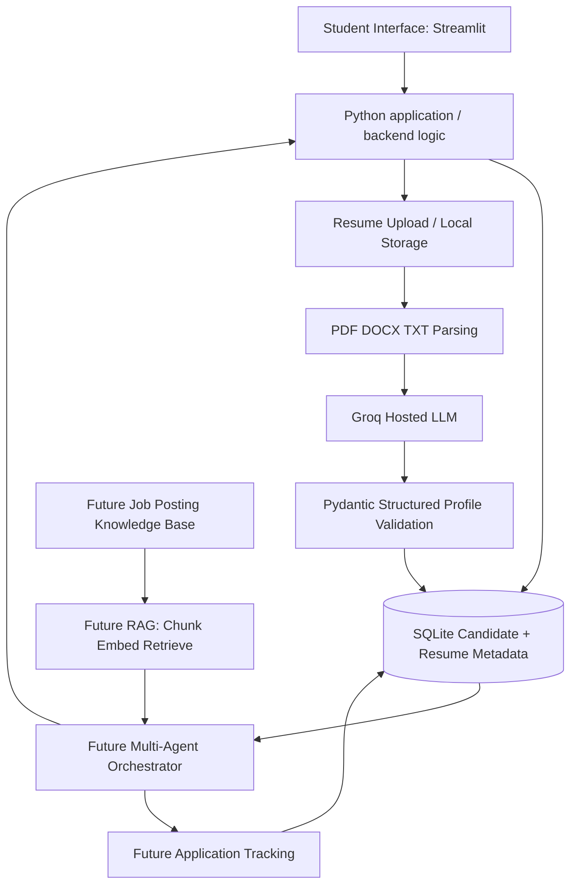

# M1.2 System Architecture

## Component diagram

## Agent specifications (planned, not implemented in M1)

| Agent | Input | Responsibility | Output |
|---|---|---|---|
| Job-Resume Matching | Candidate profile + job posting | Compare requirements and evidence | Match explanation and score |
| Skill Gap | Skills + job requirements | Identify missing competencies | Prioritized skill gaps |
| Resume | Candidate profile + resume | Recommend truthful resume improvements | Resume suggestions |
| Cover Letter | Candidate facts + selected job | Draft tailored cover letter | Editable letter draft |
| Interview | Candidate + job | Generate interview practice | Questions and feedback |
| Career Assistant | Candidate goals + agent outputs | Coordinate guidance and next steps | Action plan |

## Candidate schema

`candidates(id, full_name, email UNIQUE, phone, location, summary, skills JSON,
education JSON, experience JSON, projects JSON, certifications JSON, created_at)`

`resumes(id, candidate_id FK, filename, file_type, file_size, stored_path, uploaded_at)`

Nested education entries: `degree, institution, year, grade`.
Experience: `role, organization, duration, description`.
Projects: `name, technologies[], description`.

## End-to-end data flow

1. Student creates profile (validated name/email) → SQLite.
2. Student uploads PDF/DOCX/TXT → extension/size checks → readable text extraction.
3. Resume file is stored under random filename → metadata recorded with candidate FK.
4. Student requests AI extraction and enters Groq API key.
5. Extracted text goes to hosted LLM with factual JSON instructions.
6. Pydantic validates JSON types and fields → SQLite candidate structured columns.
7. Student reviews structured fields; extraction errors remain visible.

## Design considerations

- Current implementation is a local, single-operator prototype without authentication.
- File upload and LLM extraction are separate explicit actions.
- Database uses parameterized SQL; API key is entered at runtime, not persisted.
- Uploaded resumes and database are excluded from Git; resume content sent to Groq requires consent.
- Scanned PDFs require future OCR support.
- Planned RAG retrieves job requirements; it is not required to run M1 extraction.
- Later milestones can add API service separation, role-based access, queues, embeddings, and audit logs.
